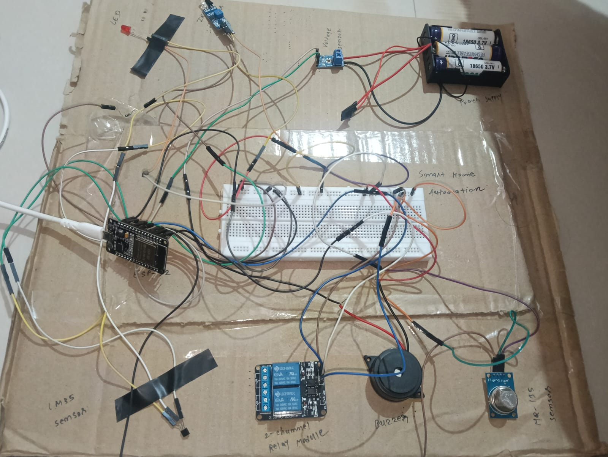
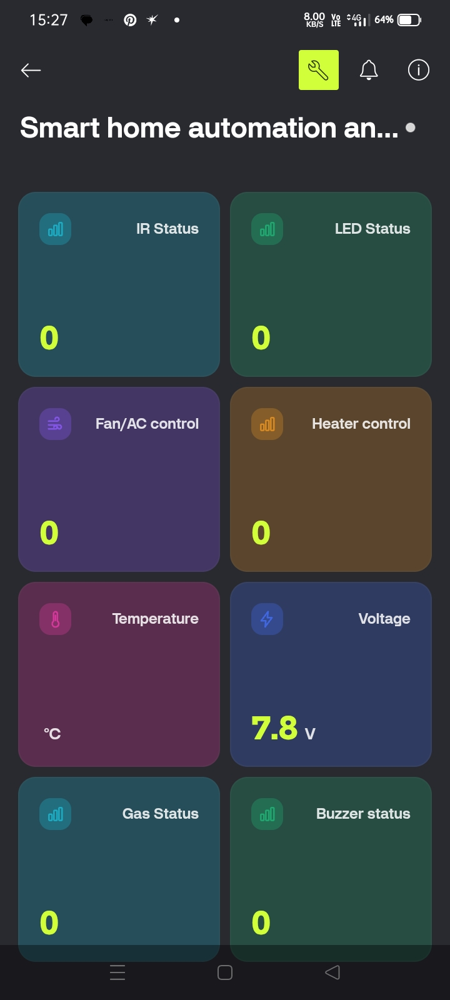
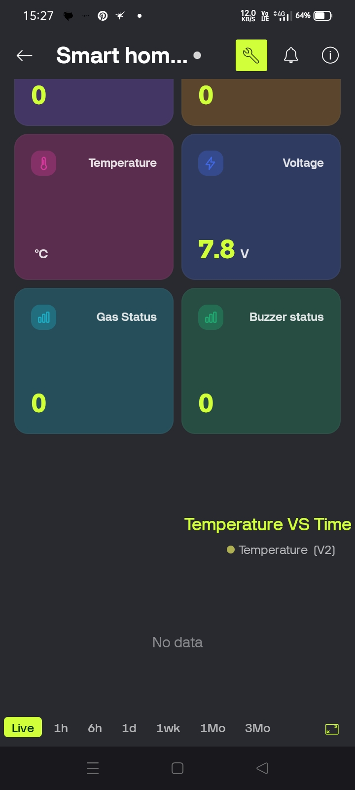

# IoT-Based Smart Home Automation & Monitoring System

An ESP32 and Blynk IoT-powered smart home automation and environmental monitoring solution. 

## Key Features
- **Remote Control:** Toggle appliances via the Blynk mobile/web dashboard.
- **Monitoring:** Real-time tracking of temperature (LM35), air quality (MQ-135), motion (IR sensor), and voltage levels.

## Tech Stack
- **Microcontroller:** ESP32
- **Sensors:** LM35, MQ-135, IR Sensor, Voltage Sensor
- **Actuator:** 5V Relay Module
- **Platform:** Blynk IoT & Arduino IDE

## Repository Structure
- [Smart_Home_ESP32.ino](./Smart_Home_ESP32.ino) – ESP32 firmware code
- [hardware_prototype.jpg](./hardware_prototype.jpg) – Hardware wiring and ESP32 prototype setup
- [blynk_dashboard1.jpg](./blynk_dashboard1.jpg) – Blynk IoT sensor monitoring dashboard
- [blynk_dashboard2.jpg](./blynk_dashboard2.jpg) – Blynk IoT appliance control dashboard

### Hardware & Dashboard Preview

#### 1. Hardware Prototype Setup

#### 2. Blynk Sensor Monitoring Dashboard

#### 3. Blynk Appliance Control Dashboard

## Author
**Trusha Tanna** | B.E. in Electronics & Communication Engineering | Government Engineering College, Bhavnagar  
- **Portfolio:** [View Live Portfolio](https://github.io) | **Email:** trushatanna0208@gmail.com
